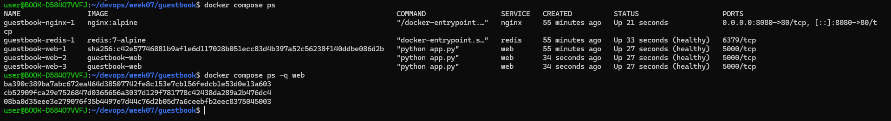
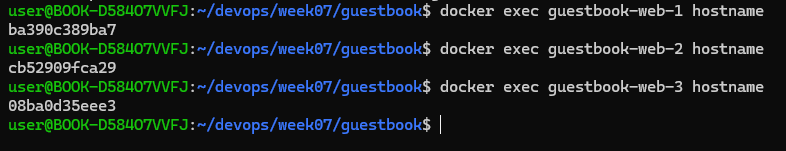

# Week 07 - Docker Compose

## 1. 컨테이너 상태 확인

docker compose ps 명령으로 컨테이너 상태를 확인했다.
web과 redis가 healthy 상태로 실행 중인 것을 확인했다.

## 2. 웹 컨테이너 Scale 확인

docker compose up -d --scale web=3 명령으로 웹 컨테이너를 3개 실행했다.
브라우저를 새로고침하면서 Pod/Host에 표시되는 컨테이너 ID가 바뀌는 것을 확인했다.

## 3. down과 down -v 비교

- docker compose down 후 다시 up하면 볼륨이 유지되어 기존 방명록 글이 남아 있다.
- docker compose down -v 후 다시 up하면 볼륨까지 삭제되어 기존 방명록 글이 사라진다.

## 4. .env를 Git에 올리지 않는 이유

.env에는 Redis 비밀번호 등 민감한 정보가 포함되어 있다.
GitHub에 올리면 비밀번호가 노출되고 Git 이력에도 남을 수 있으므로,
.gitignore에 등록하여 커밋에서 제외한다.

대신 설정에 필요한 환경변수 이름과 예시를 담은 .env.example을 공유한다.
