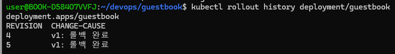

`http://guestbook/healthz`를 여러 번 호출했다.

- 첫 번째 응답의 hostname: guestbook-7ddbb7c5b5-pkg5f
- 다른 응답의 hostname: guestbook-7ddbb7c5b5-k95hk

## 3. Pod 자동 복구 확인

```bash
kubectl delete pod guestbook-7ddbb7c5b5-k95hk
kubectl get pods -w
```

삭제 후 새 이름의 Pod가 생성되어 `1/1 Running`이 됐고, 정상 Pod 5개가 유지됐다.

## 4. v1에서 v2로 업데이트하고 롤백

```bash
kubectl set image deployment/guestbook web=ghcr.io/yeon119/guestbook:v2
kubectl rollout status deployment/guestbook
kubectl rollout history deployment/guestbook
```

롤링 업데이트 후 v2가 실행되는 것을 확인했다.

```bash
kubectl rollout undo deployment/guestbook
kubectl rollout status deployment/guestbook
```

롤백 후 다시 v1이 실행되는 것을 확인했다.



## 참고

이전 실습에서 남은 13일 된 `ImagePullBackOff` Pod는 정상 실행 중인 Pod 5개와 구분했다.
