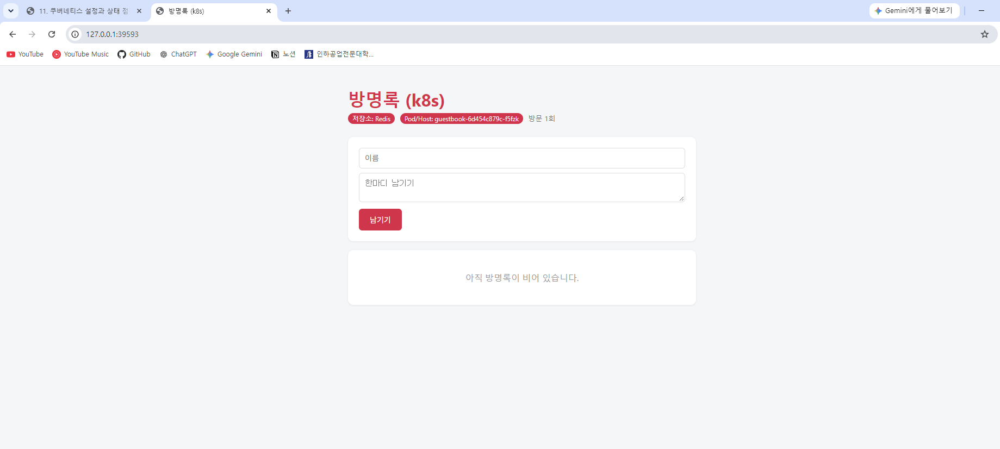
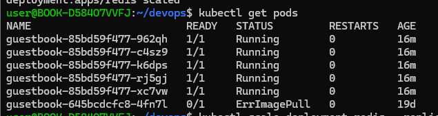
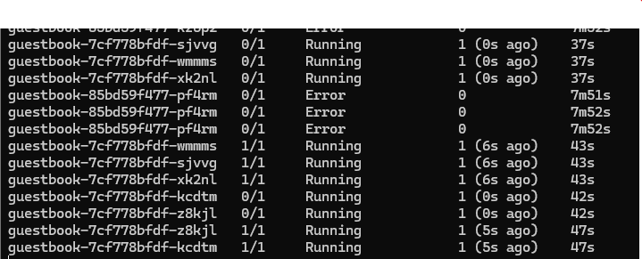

# Week 11: Kubernetes 설정과 상태 점검

## 1. ConfigMap과 Secret

`guestbook-config` ConfigMap에 제목, 색상, Redis 주소와 포트를 저장했다. `guestbook-secret`에는 Redis 비밀번호를 저장하고, 두 값을 guestbook Pod의 환경변수로 주입했다.

Secret의 값을 base64로 인코딩해도 디코딩하면 원문을 확인할 수 있었다. 따라서 **base64 인코딩은 암호화가 아니며**, Secret 파일에 실제 비밀번호를 적어 GitHub에 올리면 안 된다.

## 2. Redis 연결과 ConfigMap 변경

Redis Deployment와 Service를 만들고 guestbook에서 Redis에 연결했다. 웹 화면에 `저장소: Redis`가 표시됐고, 글을 남긴 뒤 새로고침해도 글이 유지됐다.

ConfigMap의 제목과 테마 색을 변경한 뒤 다음 명령으로 guestbook Pod를 재시작했다.

```bash
kubectl rollout restart deployment guestbook
kubectl rollout status deployment/guestbook
```

새 웹 화면에 변경한 제목과 색이 적용됐으며, Redis에 저장한 글은 유지됐다. ConfigMap을 변경해도 실행 중인 Pod의 환경변수는 자동으로 바뀌지 않으므로 재시작이 필요했다.



## 3. readiness 실패와 복구

Redis Deployment를 0개로 줄이자 guestbook Pod는 `Running`이었지만 `READY 0/1`이 됐다. `/readyz` 요청은 `503`을 반환했다. 앱 프로세스는 살아 있어도 Redis를 사용할 수 없으면 요청을 받을 준비가 되지 않았다는 뜻이다.

```bash
kubectl scale deployment redis --replicas=0
kubectl get pods
```



Redis를 다시 1개로 복구했다. Redis Pod가 `1/1 Running`이 되고 Redis Service의 Endpoints도 확인됐지만, guestbook은 한동안 `0/1`로 남았다. guestbook Pod 안에서 Redis 연결 테스트는 `True`였고, `/healthz`는 `200`, `/readyz`는 `503`이었다. guestbook Deployment를 재시작한 뒤 새 Pod 5개가 `1/1 Running`으로 복구됐다.

```bash
kubectl scale deployment redis --replicas=1
kubectl rollout status deployment/redis
kubectl rollout restart deployment/guestbook
kubectl rollout status deployment/guestbook
```

## 4. liveness 실패와 복구

livenessProbe의 경로를 실제로 없는 `/devops`로 바꾸어 실패 상황을 만들었다. Pod가 새로 생성되고 이전 Pod가 종료되는 과정을 관찰했다. 이후 올바른 `/healthz` 경로가 들어 있는 `deployment.yaml`을 다시 적용했다.

```bash
kubectl apply -f k8s/deployment.yaml
kubectl rollout status deployment/guestbook
```

복구 명령에서 `successfully rolled out`이 출력됐고, 새 guestbook Pod 5개가 `1/1 Running`이 됐다.



## 5. 오류를 찾는 3단계

1. `kubectl get pods`로 `STATUS`, `READY`, `RESTARTS`를 확인한다.
2. `kubectl describe pod`의 `Events`에서 이미지 받기 실패나 프로브 실패 같은 원인을 찾는다.
3. `kubectl logs`에서 애플리케이션의 오류와 HTTP 응답을 확인한다.

이번 실습에서는 이 순서로 `/readyz`의 `503`과 `/healthz`의 `200`을 확인해, 앱이 실행 중이지만 준비 상태가 아니라는 점을 구분했다.
